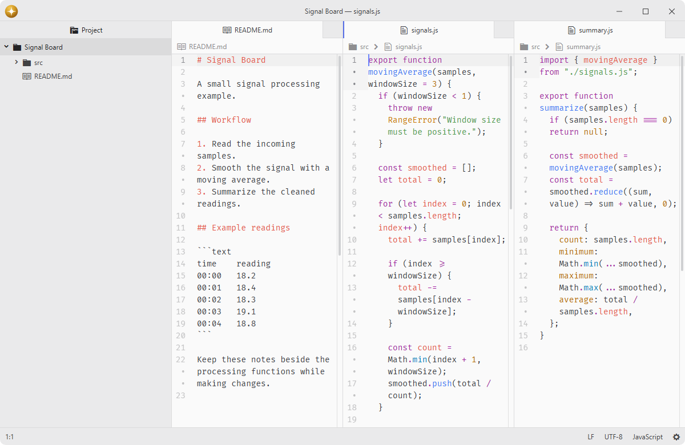
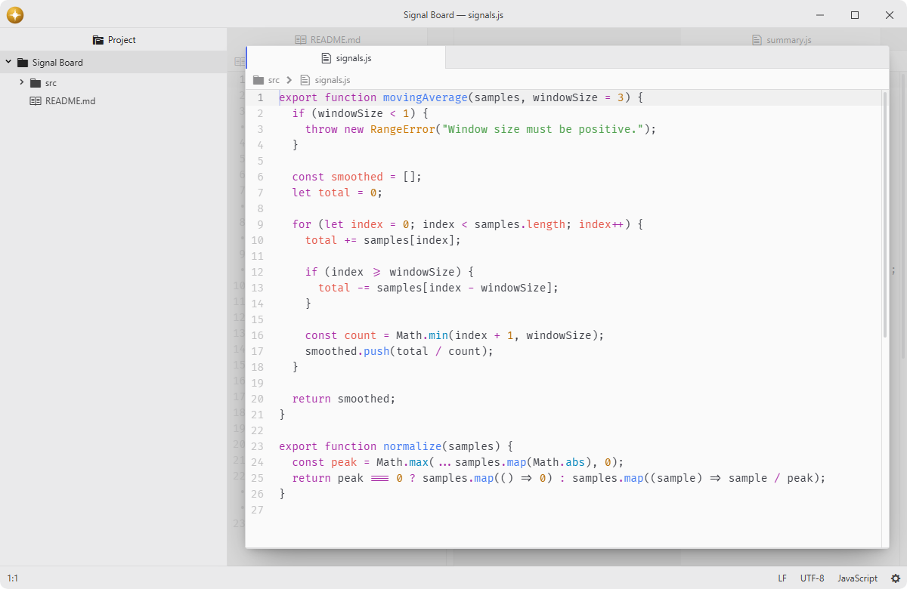

# pane-focus

Temporarily enlarge the active pane over the workspace.

## Features

- **Floating pane**: enlarge the active center pane above the existing layout with an inset frame and the theme's modal backdrop confined to the center.
- **Preserved layout**: keep every pane in its original split and restore the same proportions when focus mode ends.
- **Pane action**: focus a center pane directly from its context menu, beside Detach Pane.
- **Natural exit**: click the blurred background or activate another center pane to return to the full layout.
- **Continuous work**: switch tabs within the focused pane without leaving focus mode.
- **Theme integration**: follow the current theme's colors, rounding, and shadows, and respect reduced motion preferences.





## Installation

To install `pane-focus` search for it in the Install pane of the Lumine settings, or run the command `lumine --install lumine-code/pane-focus`.

## Commands

Commands available in `lumine-workspace`:

- `pane-focus:toggle`: toggle focus mode for a center pane.

## Usage

Choose Focus Pane beside Detach Pane in a center pane's context menu to enlarge that pane, including an inactive pane. Running `pane-focus:toggle` from the command palette enlarges the active center pane. Click the blurred background or run the command again to restore the normal layout.

During focus mode, directional pane navigation treats the center as a single pane. Explicitly activating another center pane ends focus mode and keeps that pane active. Switching tabs within the same pane, opening the command palette, or moving focus to a dock leaves focus mode enabled.

## Customization

Adjust the frame margin, background blur, and animation duration in your `styles.css`:

```css
.pane-focus {
  --pane-focus-inset: 40px;
  --pane-focus-blur: 3px;
  --pane-focus-duration: 180ms;
}
```

## Services

- `background-tips.provider`: provided to teach temporary pane enlargement on the empty workspace.

## Contributing

Got ideas to make this package better, found a bug, or want to help add new features? Just drop your thoughts on GitHub. Any feedback is welcome!
